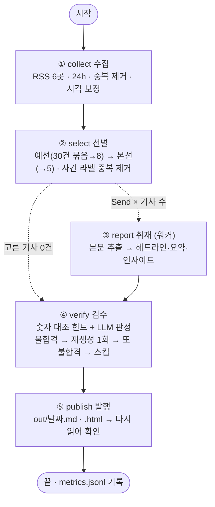

# REPORT — 혼자 파는 사람들의 아침 브리핑

1인 창업자를 위한 마케팅·커머스 뉴스레터 에이전트. LangGraph 다섯 노드
(수집 → 선별 → 취재 → 검수 → 발행)로 매일 아침 3~5건을 골라 요약하고 "이번 주 해 볼 것"을 붙인다.

## 1. 분야 및 독자 정의

**왜 이 분야인가.** 스마트스토어·SNS로 혼자 장사하는 사람에게는 플랫폼 정책·광고 상품·알고리즘이
바뀌는 소식이 곧 매출 변화다. 그런데 이 소식은 스타트업 매체·마케팅 전문지·해외 SNS 업계지에 흩어져 있고,
대부분은 대기업 실적이나 투자유치처럼 1인 사업자와 상관없는 기사에 묻혀 있다.

**독자 페르소나.** 스마트스토어·자사몰·SNS로 디지털 상품이나 서비스를 혼자 파는 1인 창업자.
대행사 없이 광고·콘텐츠·고객 응대를 직접 하고, 아침 10분 안에 "오늘 내 가게에 영향을 줄 소식"만 알고 싶다.

**중요도 판단 문장.** *이번 주 안에 내 매출·광고비·운영 방식이 바뀔 만한 소식인가?*

| 고를 것 | 버릴 것 |
|---|---|
| 1. 플랫폼(네이버·쿠팡·틱톡·인스타·유튜브·메타·구글)의 정책·수수료·알고리즘·광고 상품 변화 | 대기업 실적, 대형 투자유치·M&A |
| 2. 소상공인·1인 창업자 대상 지원사업, 세금·규제 변화 | 인사·행사·수상·MOU 홍보 |
| 3. 혼자 바로 써 볼 수 있는 마케팅 전술·도구(특히 AI 도구)와 근거 데이터 | 발표 예정·로드맵만 있는 소식 |
| 4. 소비자 행동·검색 트렌드 변화를 보여 주는 조사 | |

모든 기준은 `audience.yaml` 에 있다. 분야를 바꿀 때 코드는 고치지 않는다 (1028 회고의 "설정과 코드 결합" 해결).

## 2. 소스 채택표

강의에서 쓴 6개 소스(OpenAI, DeepMind, TechCrunch, The Verge, MIT TR, AI타임스)는 제외 조건이라 후보에 넣지 않았다.
후보 20곳을 빠르게 훑은 뒤([tools/probe.py](tools/probe.py)) 12곳을 관문 네 개로 측정했다([tools/measure_sources.py](tools/measure_sources.py)).

| 관문 | 기준 | 이유 |
|---|---|---|
| G1 접근 | HTTP 200, 항목 1개 이상 | 막히면 매일 실패한다 |
| G2 최신성 | 최근 24시간 글 ≥ 1 | 수집 기간이 24시간 |
| G3 본문 | 최근 3건 모두 원문 600자 이상 추출 | RSS 요약만으로는 요약 근거 부족 (1028 G1 기준선) |
| G4 적합도 | 최근 30건 제목 중 독자 키워드 비율 ≥ 25% | 종합 IT 매체는 독자와 무관한 기사가 대부분 |

측정 결과 (2026-10-29, `store/sources.md`):

| 소스 | HTTP | 항목 | 24h 신규 | 본문추출 | 적합도 | 판정 | 근거 |
|---|---|---|---|---|---|---|---|
| 벤처스퀘어 | 200 | 30 | 27 | 3/3 | 27% | **채택** | 관문 4개 통과 |
| 플래텀 | 200 | 10 | 8 | 3/3 | 40% | **채택** | 관문 4개 통과 |
| 모비인사이드 | 200 | 50 | 5 | 3/3 | 33% | **채택** | 관문 4개 통과 |
| Social Media Today | 200 | 10 | 6 | 3/3 | 60% | **채택** | 관문 4개 통과 |
| Marketing Dive | 200 | 10 | 5 | 3/3 | 50% | **채택** | 관문 4개 통과 |
| 스타트업투데이 | 200 | 50 | 9 | 3/3 | 30% | **채택** | 관문 4개 통과 |
| Entrepreneur | 200 | 10 | 10 | 3/3 | 20% | 탈락 | G4 적합도 20% |
| 바이라인네트워크 | 200 | 20 | 10 | 3/3 | 10% | 탈락 | G4 적합도 10% |
| 블로터 | 200 | 50 | 50 | 3/3 | 13% | 탈락 | G4 적합도 13% |
| Inc. | 200 | 40 | 40 | 0/3 | 27% | 탈락 | G3 본문 추출 0/3 |
| Search Engine Land | 403 | 0 | 0 | - | 0% | 탈락 | G1 접근 거부 |
| Shopify Blog | 200 | 0 | 0 | - | 0% | 탈락 | G1 항목 없음 |

**측정하며 발견한 것**
- 국내 피드 일부(블로터·디지털투데이·스타트업투데이)는 **한국 시각에 `+0000`을 붙여** 최신 글이 −9시간(미래)으로 보였다.
  수집 노드에서 "10분 이상 미래면 9시간을 뺀다"로 보정하고 보정 건수를 로그에 남긴다.
- 10건만 주는 피드(Social Media Today·Marketing Dive)는 하루 1회 수집으로도 놓치는 글이 없는 수준(하루 5~6건)인지 확인했다.
- 벤처스퀘어는 측정 때는 통과했지만 첫 실행에서 HTTP 오류가 났다. 수집 노드가 멈추지 않고 `응답 없음 ['벤처스퀘어(HTTPError)']`를 로그에 남겼다.

## 3. 선별 로직 설계

**2단계 상대평가 (예선 → 본선).** 1028에서 개별 점수(Pointwise)는 동점 때문에 순위를 못 가렸다.

| 설정 | 값 | 이유 |
|---|---|---|
| 예선 묶음 크기 `batch` | 30 | 하루 수집량이 25~60건. 한 화면 30건이면 중간 정보 손실(lost in the middle)이 작고 호출은 1~2번 |
| 묶음별 통과 `survivors_per_batch` | 8 | 최종 5건보다 넉넉하게 — 예선에서 좋은 기사가 떨어질 위험을 줄인다 |
| 본선 후보 | target × 2 = 10 | 같은 사건·소스 상한으로 빠지는 자리를 채우기 위해 |
| 본선 입력 | 제목 + RSS 요약 200자 | 제목만으로는 "해외 한정" 같은 조건을 알 수 없었다 (§5 회차 2) |
| 소스당 상한 `max_per_source` | 2 | 첫 실행에서 한 소스가 5건 중 4건을 차지했다 (§5 회차 1) |
| 최종 `target` | 5 (최소 3) | 3건 미만이면 `⚠ 최소 3건 미달`을 로그에 남긴다 |

**근거를 남기는 방법.** 본선에서 LLM은 기사마다 `reason`(독자 관점 이유), `criterion`(해당하는 "고를 것" 번호),
`event`(사건 라벨)를 함께 낸다. 같은 `event`는 하나만 남긴다. 이 라벨 전부가
`store/metrics.jsonl` 의 `select.labels` 에 들어가므로, "왜 이 5건인가"를 실행마다 다시 확인할 수 있다.

## 4. 파이프라인 구조도



**State**

| 칸 | 쓰는 곳 | 리듀서 |
|---|---|---|
| `hours`, `mode` | 시작 | 없음 |
| `collected` | collect | 없음 (한 곳만 씀) |
| `picked` | select | 없음 |
| `drafted` | report 워커 여럿 | `operator.add` |
| `verified` | verify | 없음 |
| `stats`, `log` | 모든 노드 | `operator.add` |

**자동 검수와 예외 처리**
1. **숫자 대조(규칙):** 요약 속 숫자가 원문에 글자 그대로 없으면 목록으로 만든다. 1028에서 환산(`$60 million → 6000만 달러`)을
   오탐했으므로 **판정이 아니라 LLM 판정자에게 주는 힌트**로만 쓴다.
2. **LLM 판정(LLM-as-a-Judge):** 헤드라인·요약이 원문에서 뒷받침되는지 `ok` / `problems`로 받는다.
3. **대안 ① 재생성:** 불합격이면 `problems`를 붙여 한 번 다시 쓰게 하고 다시 판정한다 (`pass_after_retry`).
4. **대안 ② 스킵:** 또 떨어지면 그 기사는 빼고 나머지만 발행한다 (`dropped`). 서비스는 멈추지 않는다.
5. **본문 부족:** 원문이 600자 미만이면 취재 단계에서 제외하고 로그에 남긴다.
6. **조용한 날:** 고른 기사가 0건이어도 "오늘은 조용합니다" 브리핑을 발행한다.
7. **발행 확인:** 파일을 쓴 뒤 다시 읽어 헤드라인이 모두 들어갔는지 확인한다.

## 5. 실행 기록

```bash
python run.py              # LLM 실행 (.env 의 OPENAI_API_KEY)
python run.py --offline    # 키 없이 배선 점검
```

**offline 실행 (2026-10-29, 배선 점검)** — LLM 대신 키워드 규칙으로 돌려 다섯 노드가 끝까지 도는지 확인했다.

```
① 수집   24시간 · 25건 {'플래텀': 8, '모비인사이드': 5, 'Social Media Today': 6, 'Marketing Dive': 5, '스타트업투데이': 1} · 시각 보정 1건 · 응답 없음 ['벤처스퀘어(HTTPError)']
② 선별   25 → 예선 8 → 본선 5건
④ 검수   5 → 5건
⑤ 발행   5건 → out/2026-10-29.md, out/2026-10-29.html · 확인 OK
기록   store/metrics.jsonl · LLM 호출 0회 · 11.8초
```

**LLM 실행 — 세 번 고쳐 가며 돌렸다 (2026-10-29, gpt-4.1-mini, 실행당 LLM 13~15회 · 약 45초)**

| 회차 | 바꾼 것 | 결과 | 남은 문제 |
|---|---|---|---|
| 1 | (첫 실행) | 5건 발행, 검수 5/5 | 5건 중 **4건이 Social Media Today**, 메타 소식 3건. 필리핀 전용 어린이 앱·미국 전용 맛집 가이드처럼 **한국에서 못 쓰는 기능**이 뽑힘. `topic` 칸에 선택지 전체가 그대로 들어감 |
| 2 | 소스당 최대 2건(`max_per_source`), "해외 한정·같은 회사 중복" 버릴 것 추가, `topic` 을 `Literal` 로 고정 | 소스 3곳으로 분산, 같은 사건(뮤즈) 제외 | 필리핀 전용 앱이 **여전히 1위**. 본선이 **제목만** 보고 고르기 때문에 "해외 한정"이라는 사실을 알 수 없었다 |
| 2′ | (코드 동일, 재실행) | 검수 **4/5** — 재생성 후에도 불합격으로 스킵 | 판정자가 `$15 billion → 150억 달러`(맞는 환산)를 틀렸다고 판정. **판정자도 환산에서 틀린다** |
| 3 | 본선에 RSS 요약 200자 포함, 판정 프롬프트에 "million=백만, billion=10억 으로 직접 환산" 추가 | 5건 발행, 소스 **4곳**, 해외 한정 앱 탈락. 검수에서 `6월 31일`(없는 날짜) **환각을 잡아 재생성 후 통과** | 아래 '남은 문제' |

최종 실행 로그:

```
모드: llm · 모델 gpt-4.1-mini
① 수집   24시간 · 51건 {'벤처스퀘어': 27, '플래텀': 7, '모비인사이드': 5, 'Social Media Today': 6, 'Marketing Dive': 5, '스타트업투데이': 1} · 시각 보정 1건
② 선별   51 → 예선 16 → 본선 5건
   ✓ [AI 기반 마케팅 자동화 도구 공개] 기준3 벤처스퀘어 · 피처링, 1800만 인플루언서 데이터 기반 AI 에이전트 공개
   · [AI 기반 마케팅 자동화 도구 공개] 기준3 벤처스퀘어 · 애딧앤아크, 인스타그램 콘텐츠 맥락 분석 '애딧 렌즈' (같은 사건)
   ✓ [가을 세탁 트렌드 데이터 발표] 기준4 벤처스퀘어 · 중기부, K-수출전략품목 188개 선정…올리브영·무신사 등과 글로벌
   ✓ [메타 AI 광고 및 앱 업데이트] 기준1 Social Media Today · Meta says its expanded processing capacity
   ✓ [AI 실무 강의 인기] 기준3 플래텀 · 직장인 실무 강의 판매 상위 13개 모두 AI, 1위는 바이브코딩
   ✓ [AI 콘텐츠 분쟁 포럼 개최] 기준2 스타트업투데이 · 한국콘텐츠진흥원, AI 콘텐츠 분쟁 해법 논의
   · [B2B 선정산 서비스 성장] 기준2 벤처스퀘어 · 올라핀테크, 식품 납품 기업 선정산 80억원 돌파 (소스 상한)
   · [프랜차이즈 마케팅 콘퍼런스 개최] 기준1 벤처스퀘어 · 마이프차, 토스플레이스·당근·배민·카카오와… (소스 상한)
④ 검수   5 → 5건
   ✓ pass             피처링, 1800만 인플루언서 데이터 기반 AI 에이전트 공개
   ✓ pass_after_retry 중기부, 188개 K-수출전략품목 선정… · ["'6월 31일까지 팝업스토어' — 원문은 5월 26~31일. 6월 31일은 존재하지 않는 날짜"]
   ✓ pass             메타, AI 강화된 광고 시스템으로 클릭 8.3%·전환 15.7% 증가
   ✓ pass             직장인 실무 강의 상위 13개 모두 AI 관련, 1위는 '바이브코딩'
   ✓ pass             한국콘텐츠진흥원, AI 콘텐츠 분쟁 대응 위한 11월 6일 포럼 개최
⑤ 발행   5건 → out/2026-10-29.md, out/2026-10-29.html · 확인 OK
기록   store/metrics.jsonl · LLM 호출 15회 · 43.3초
```

- 회차별 브리핑: `store/run1_2026-10-29.md`, `store/run2_…`, `store/run3_…`(2′), 최종 `out/2026-10-29.md`·`.html`
- 실행 기록: `store/metrics.jsonl` (offline 점검 포함 전 실행. `mode` 칸으로 구분)
- *발행 화면 캡처: `out/2026-10-29.html` 을 브라우저로 연 화면을 여기에 붙인다.*

**최종 결과에 남은 문제 (숨기지 않고 적는다)**
- **사건 라벨이 기사와 어긋난 경우가 있다.** 중기부 수출품목 기사에 "가을 세탁 트렌드" 라벨이 붙었다. 모델이 번호와 다른 기사를 보고 라벨을 쓴 것으로 보인다. 같은 사건 거르기가 이 라벨에 의존하므로 오판 위험이 있다.
- **요약이 "딱 세 문장"을 지키지 않는다** (4~5문장, `~다`/`~합니다` 혼용). 스키마 설명만으로는 강제되지 않는다 — 1028 섹션 6의 "프롬프트만으로는 보장할 수 없다"와 같은 현상.
- **원문 속 지난 정보가 그대로 실린다.** 중기부 기사 본문에 있던 "5월 26~31일 팝업스토어"가 10월 브리핑의 인사이트("방문해 보세요")로 들어갔다. 검수는 '원문과 맞는가'만 보므로 **원문이 맞으면 낡은 정보도 통과**한다.
- `topic` 이 대부분 "마케팅 전술" 하나로 몰린다.

## 6. 프로젝트 회고

**가장 공들인 부분**
- **소스를 숫자로 고른 것.** 처음엔 "마케팅 매체니까 되겠지" 싶었던 Entrepreneur·블로터가 적합도 측정에서 떨어졌고,
  Inc.는 제목은 좋았지만 본문 추출이 0/3이었다. 관문을 숫자로 두니 채택·탈락 이유를 한 줄로 설명할 수 있다.
- **실패해도 멈추지 않는 흐름.** 소스 하나가 죽어도, 요약 하나가 검수에 떨어져도, 기사가 0건이어도 발행까지 간다.
  그리고 각 경우가 로그와 metrics 에 남는다.

- **실행 결과를 보고 고친 세 번.** 검수 5/5 통과라는 숫자만 보면 첫 실행도 "성공"이었다. 실제 브리핑을 읽어 보니
  한 소스가 독차지했고 독자가 못 쓰는 기능이 올라와 있었다. 로그의 선별 라벨(`✓`/`·`와 탈락 사유)을 남겨 둔 덕분에
  "왜 그 기사가 뽑혔나"를 추적해 원인(본선이 제목만 본다)을 찾을 수 있었다.

**보완하고 싶은 것**
- **라벨과 기사 대조:** 본선 결과의 `event` 라벨이 실제 기사 제목과 맞는지 한 번 더 확인하는 검사.
- **시의성 검사:** 요약·인사이트 속 날짜가 오늘보다 과거면 경고하거나 빼는 규칙.
- **문장 수 강제:** 요약을 `list[str]`(정확히 3개)로 받아 코드에서 이어 붙인다.
- **평가셋:** 며칠치 수집 결과에 사람이 "골라야 했던 기사"를 표시해 두고, 프롬프트를 바꿀 때마다 선별 적중률을 잰다.
- **사람의 발행 전 승인:** 검수 통과분을 바로 내보내지 말고 승인 버튼을 거치게 한다.
- **역할별 모델:** 예선(가벼운 비교)은 더 싼 모델, 요약·판정은 더 좋은 모델로 나눈다.
- **발행 채널:** 지금은 파일(HTML/MD)로만 낸다. 이메일이나 메신저로 보내고 GitHub Actions로 매일 07:30에 돌린다.

## 부록. 도구·하네스 사용 여부

**① 에이전트 안에서 돌아가는 도구** (뉴스레터를 실제로 만드는 부품)

| 도구 | 사용 | 이유 |
|---|---|---|
| LangGraph | ✅ | 수집→선별→취재→검수→발행을 그래프로 잇고, 검수 실패 시 재작성·건너뛰기 같은 갈림길을 조건부 간선으로 표현하기 위해. `Send`로 기사 수만큼 취재를 펼칠 수 있다 |
| feedparser | ✅ | 6개 매체의 RSS를 같은 모양으로 읽기 위해 |
| trafilatura | ✅ | 기사 페이지에서 광고·메뉴를 빼고 본문만 뽑기 위해 (G3 본문 관문의 기준) |
| requests | ✅ | 일부 매체가 기본 요청을 막아 브라우저 UA 헤더를 붙여 받기 위해 |
| OpenAI `gpt-4.1-mini` | ✅ | 순위 매기기·요약·인사이트·검수 판정. 1028 강의와 같은 모델이라 결과를 비교할 수 있고, 하루 수십 번 호출해도 비용이 작다 |
| pydantic (구조화 출력) | ✅ | 모델 답을 `Pick`·`Draft`·`Verdict` 칸에 맞춰 받아, 문장 파싱 없이 코드가 바로 쓰게 하기 위해 |
| PyYAML | ✅ | 독자·소스·선별 기준을 코드 밖 `audience.yaml`에 두어 코드 수정 없이 바꾸기 위해 |
| python-dotenv | ✅ | API 키를 코드에 적지 않고 `.env`에서 읽기 위해 (`.env`는 저장소에 올리지 않음) |
| LangChain | ❌ | LangGraph와 OpenAI SDK만으로 충분했다. 감싸는 층이 하나 늘면 오류 위치를 찾기 어렵다 |
| 웹 검색 API (Tavily 등) | ❌ | 소스를 직접 골라 관문으로 검증하는 것이 과제의 핵심이다. 검색 결과는 출처를 통제할 수 없고 키·비용이 추가된다 |
| 벡터 DB / RAG | ❌ | 매일 24시간 안의 새 기사만 다루므로 과거 문서를 찾아올 일이 없다 |
| LangSmith 등 추적 서비스 | ❌ | 로그와 `store/metrics.jsonl`로 단계별 건수·탈락 사유를 충분히 추적했다. 외부 계정·키를 늘리지 않았다 |
| 이메일·메신저 발송 | ❌ | 발행 채널을 파일(HTML/MD)로 정했다. 키·수신자 정보 없이 결과를 확인·제출할 수 있다 |
| GitHub Actions 예약 실행 | ❌ | 아직 하지 않았다. 매일 자동 실행은 회고의 "보완하고 싶은 것"에 남겨 두었다 |

**② 개발을 도운 도구** (에이전트를 만드는 과정에서 쓴 것)

| 도구 | 사용 | 이유 |
|---|---|---|
| Claude Code (기본 하네스) | ✅ | 코드 작성·실행·로그 읽기·수정을 한 자리에서 하기 위해. 파일 읽기·쓰기, 명령 실행 같은 기본 도구만 썼다 |
| 강의 추출 스크립트 (`lecture-extract`) | ✅ | 강의 mhtml에서 과제 요구사항 본문을 뽑기 위해. 이미 만들어 둔 것을 재사용했다 |
| OMC (oh-my-claudecode) | ❌ | 이 과제는 "실행 → 브리핑을 사람이 읽음 → 고침"을 반복하는 일이라, 결과가 좋은지 판단하는 사람이 매 회차에 끼어야 했다. `autopilot`·`ralph` 같은 자동 반복은 그 판단 없이 유료 API를 계속 호출할 수 있다. 작업 폴더에 커밋 안 된 폴더가 많아 자동 모드를 돌리면 되돌리기도 어렵다 |
| 서브에이전트·팀 모드 | ❌ | 파일이 몇 개뿐인 작은 프로젝트라 나눠 맡길 만큼 일이 크지 않았다. 나누면 오히려 맥락 전달에 손이 더 든다 |
| CodeGraph (코드 색인) | ❌ | 이 프로젝트는 색인이 없고, 파일이 작아 직접 읽는 편이 빨랐다 |
| Jupyter 노트북 | ❌ (로컬) | 1028 실습은 LMS 노트북으로 했지만, 로컬에서는 `--step`으로 단계를 골라 돌리는 `.py` 파일로 바꿔 반복 실행을 쉽게 했다 |
